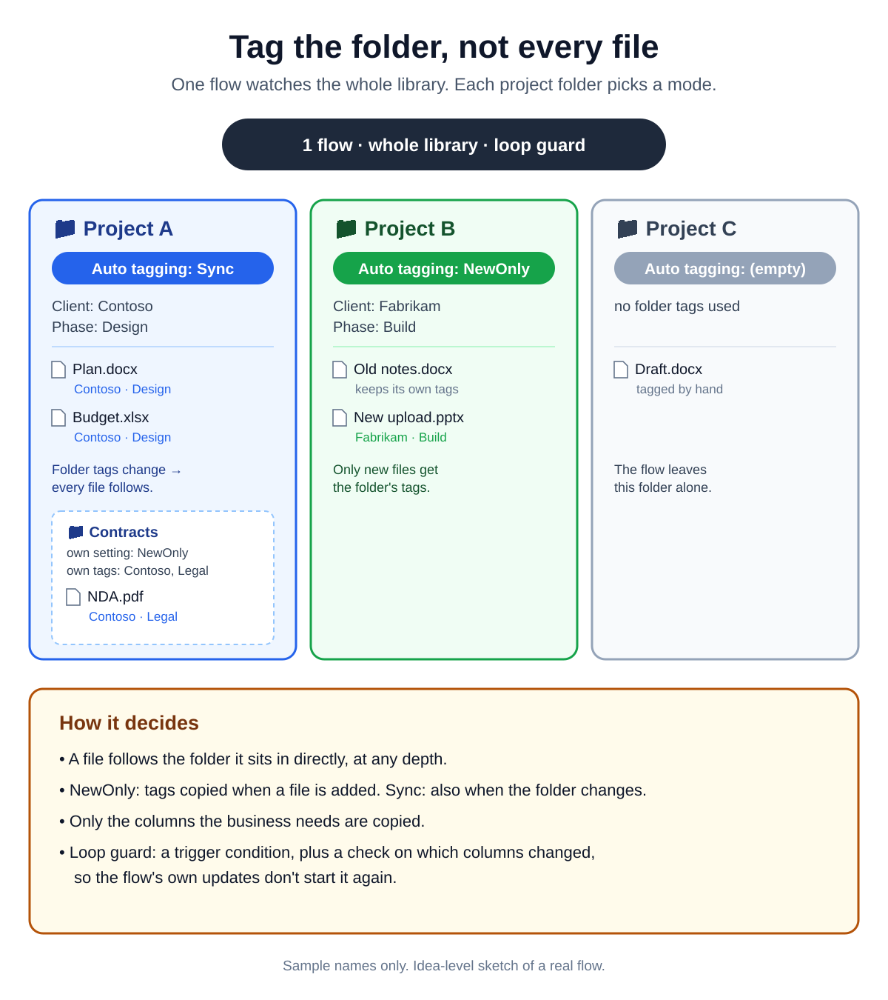

# 008 · Tag a folder once: one flow syncs folder tags to files

An idea-level sketch of a real flow. Each folder in the library is a project. People tag the **folder**;
one flow for the whole library copies those tags to the files inside.

## Why not default column values?
SharePoint's *Column default value settings* can set defaults per folder, but:
- someone has to configure them in library settings for **every new folder**, and
- they apply to **new uploads only** — existing files keep what they had.

## The setup
- Extra choice column on folders: **Auto tagging**
  - **NewOnly** — a new file gets the folder's tags when it's added
  - **Sync** — the same, and when the folder's tags change, every file in it is updated
  - *(empty)* — off: the flow leaves the folder alone
- With **NewOnly**, files that were already there keep their own tags.
- Only a chosen set of columns is copied (the ones the business needs), not every field.
- A file always follows the folder it sits in **directly**, at any depth. A subfolder can have its own tags and mode.

## Loop guard
Updating a file's properties is itself a modification, so the flow could keep triggering itself.
Two checks stop that:
1. A **trigger condition** on *When a file is created or modified (properties only)*, so most of those runs never start.
2. A **condition inside the flow** that looks at which columns actually changed before updating anything.

📎 LinkedIn post: _link coming soon_
