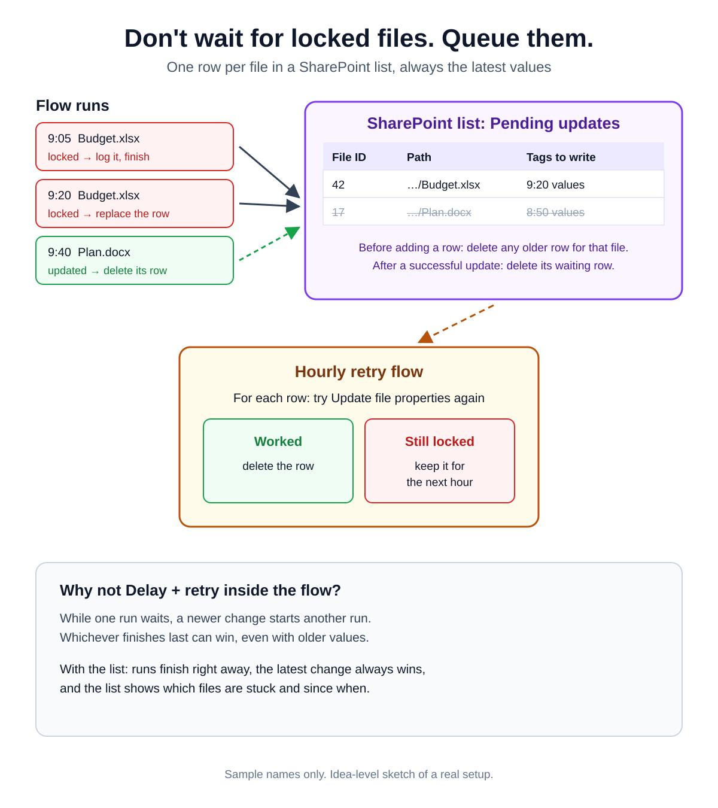

# 011 · Locked files: a latest-only retry list instead of waiting in the flow

An idea-level sketch of a real setup (the auto-tagging flow from [008](../008-folder-auto-tagging/)).

## The problem with Delay + retry inside the flow
On a busy site, while one run waits for a locked file, a newer change starts another run. Whichever finishes last
**can** win, even if it carries the older values.

## The list: one row per file
SharePoint list, e.g. **Pending updates**:

| Column | Type | Example |
|---|---|---|
| FileID | Number | `42` |
| FilePath | Single line of text | `Shared Documents/Project A/Budget.xlsx` |
| TagsToWrite | Multiple lines of text (JSON) | `{"Client":"Contoso","Phase":"Design"}` |

## In the flow that hits the lock
1. **Update file properties** → next steps with **Configure run after → has failed**
2. Check the error is a lock: `contains(coalesce(body('Update_file_properties')?['message'], ''), 'locked for shared use')`
3. **Get items** on the list, Filter Query: `FileID eq 42` (use the file's ID) → **Delete item** for each result
4. **Create item** with the file ID, path and the values it wanted to write

After a **successful** update, the flow also looks up the file ID in the list and deletes any waiting row, so the
hourly retry can't bring back older values.

## The hourly retry flow
1. **Recurrence** — every hour
2. **Get items** on the list
3. **Apply to each** row: **Update file properties** with the stored values
   - succeeded → **Delete item**
   - still locked (run after: has failed) → keep the row for the next hour

## Edge cases to plan for
- **File deleted or moved while waiting** — the retry fails every hour; remove the row when the file is gone (e.g. 404).
- **Two runs hit the lock at the same moment** — both may find no row and both insert one. Options: enable
  *Enforce unique values* on FileID and turn a failed insert into an update, or keep only the newest row per file in
  the hourly flow.

📎 LinkedIn post: _link coming soon_
